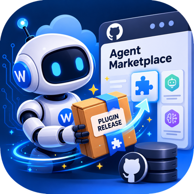

# WordLift Agent Marketplace

<p align="center">
  
</p>

Marketplace metadata for WordLift agent plugins.

This repository is intentionally a catalog. Plugin implementation files stay in
their source repositories; marketplace entries point to Git-backed plugin
sources.

## Available Plugins

- `graph-sync-agent-kit`: graph-sync curation, project implementation, repository
  lifecycle, YARRRML review, postprocessor authoring, and GitHub workflow review.
- `wordlift-skills`: checking a WordLift knowledge graph with its API key, Graph
  KPI and GEO lift reports, and WordLift brand design. Its repository is private:
  installing it needs read access to `wordlift/intra-skills` and Git signed in
  to GitHub without a prompt (`gh auth login`, then `gh auth setup-git`).

## Codex

Add the marketplace:

```bash
codex plugin marketplace add wordlift/agent-marketplace --ref main
```

Install the plugins:

```bash
codex plugin add graph-sync-agent-kit@wordlift
codex plugin add wordlift-skills@wordlift
```

## Claude Code

Add the marketplace:

```bash
claude plugin marketplace add wordlift/agent-marketplace
```

Install the plugins:

```bash
claude plugin install graph-sync-agent-kit@wordlift
claude plugin install wordlift-skills@wordlift
```

## Gemini CLI

Gemini CLI doesn't read this marketplace: it installs each plugin as an extension
straight from its repository.

```bash
gemini extensions install https://github.com/wordlift/graph-sync-agent-kit
gemini extensions install https://github.com/wordlift/intra-skills
```

## Repository Layout

```text
.agents/plugins/marketplace.json
.claude-plugin/marketplace.json
scripts/validate_marketplace.py
```

## Maintenance

Each plugin's release tags update this marketplace automatically. The plugin's
release workflow updates its Codex and Claude Code `ref` values, then pushes the
marketplace commit through the WordLift marketplace GitHub App.

To add a plugin, add one entry for it to each catalog, pointing at a release tag
of a `wordlift/<repo>` repository, and give that repository the same release
workflow. `scripts/validate_marketplace.py` checks that both catalogs list the
same plugins with the same repository and tag.

For manual maintenance, keep Codex and Claude entries aligned and point each
plugin `ref` to a release tag from the source repository.
